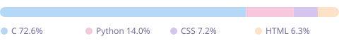

<h1 align="center">🌸 Oi, eu sou a Ana Luisa! ☁️</h1>

  

---

### 🎨 Linguagens que mais uso

  

Atualizado automaticamente todo dia via GitHub Actions.

---

### 🚀 Pelo que eu me apaixono

- 🛰️ Foguetes universitários e aeroespacial
- 🔌 Placas PCB e esquemáticos eletrônicos
- 🤖 Programação embarcada (microcontroladores, firmware)

---

### 📊 Estatísticas

  
  

